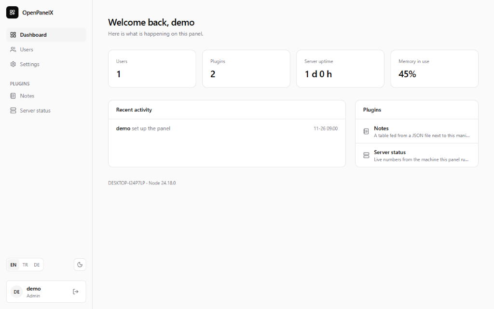
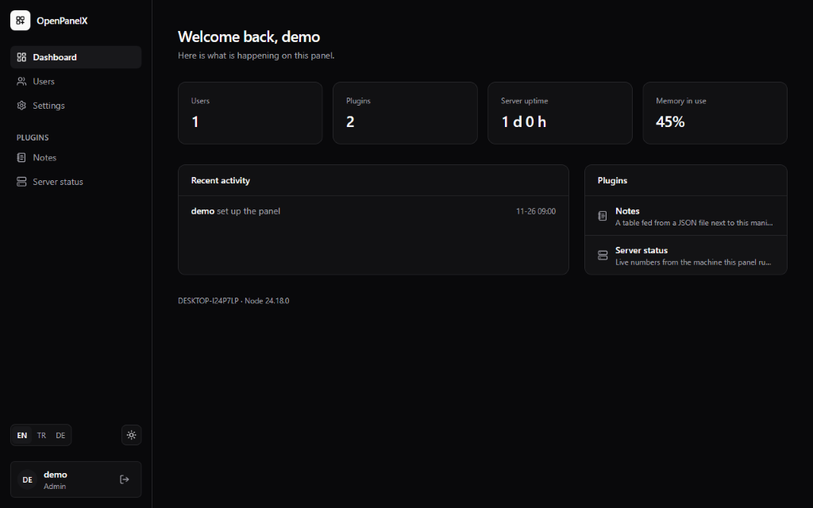

# OpenPanelX

[](https://github.com/gokhangozukara/OpenPanelX/actions/workflows/ci.yml)
[](LICENSE)

A small, clean, plugin-ready admin panel with zero external database setup. Sign-in, roles, two-step verification, folder plugins, and a JSON API work out of the box.




## Features

- **Sign-in and roles built in.** First visit creates the first admin. Roles: `admin`, `editor`, `viewer`, with inline role updates on the Users page.
- **Two-step sign-in (2FA).** Optional per user in Settings. Works with any authenticator app (Google Authenticator, Authy, 1Password…). Generates 8 one-time recovery codes, blocks code replay, and lets admins reset 2FA for locked-out users.
- **Plugins are folders.** Drop a folder with a `plugin.json` into `plugins/`. It appears in the sidebar immediately — no rebuild required.
- **Interactive tables.** Search rows, add, edit inline, delete, and export to CSV. Edits are saved in `data/plugins/`, never inside the plugin folder.
- **JSON API.** Read plugins and manage editable table rows over HTTP (`/api/health`, `/api/plugins`, `/api/plugins/[id]/tables/[index]`).
- **English, Turkish, German.** Light and dark themes.
- **Zero external database.** Next.js, Tailwind CSS, and Node.js 24's built-in SQLite.

## Quick start (Node.js)

Requires [Node.js](https://nodejs.org) 24+ and Git.

```sh
git clone https://github.com/gokhangozukara/OpenPanelX.git
cd OpenPanelX
npm install
npm run build
npm start
```

Open `http://localhost:3100` and create your admin account.

- Custom port: `npm start -- -p 8080`
- Development mode: `npm run dev`
- Over plain HTTP on a non-localhost address, browsers refuse `Secure` cookies. Put OpenPanelX behind HTTPS, or for local private testing set `OPENPANELX_INSECURE=1`.

## Quick start (Docker)

```sh
git clone https://github.com/gokhangozukara/OpenPanelX.git
cd OpenPanelX
docker compose up -d
```

Open `http://localhost:3100`. Persistent SQLite data and secrets are stored in the `openpanelx_data` volume (`/app/data`).

## Write a plugin

Create `plugins/my-plugin/plugin.json`:

```json
{
  "name": { "en": "My plugin", "tr": "Eklentim", "de": "Mein Plugin" },
  "icon": "list",
  "minRole": "viewer",
  "sections": [
    { "type": "stats", "items": [{ "label": "Open tasks", "value": 7 }] },
    {
      "type": "table",
      "title": "Tasks",
      "columns": [{ "key": "title", "label": "Title" }],
      "file": "data.json",
      "editable": true
    },
    { "type": "text", "title": "About", "body": "Anything you like." }
  ]
}
```

- Folder names: lowercase letters, numbers, and dashes.
- `name`, `title`, `label`, `body` can be plain text or `{ "en": "", "tr": "", "de": "" }`.
- `minRole`: `viewer`, `editor`, or `admin`. Users below it do not see the plugin.
- Section types: `stats`, `table`, `text`. Tables read rows from `rows` or from a JSON file inside the plugin folder.
- Add `"editable": true` to a table so editors and admins can add, edit, and delete rows (stored in `data/plugins/`, up to 1000 rows and 500 characters per cell).
- Live server metrics for stats: `"source": "@system.uptime"`, `@system.memory`, `@system.cpus`, `@system.load`, `@system.host`.
- Icons: `dashboard`, `users`, `settings`, `puzzle`, `notebook`, `activity`, `server`, `list`.

A broken plugin is skipped safely and never takes the panel down.

## HTTP API

All plugin endpoints require an active signed-in session cookie, and mutation endpoints enforce same-origin checks:

- `GET /api/health` — public health check (`{ ok, name, version, uptime }`)
- `GET /api/plugins` — list plugins visible to the signed-in user
- `GET /api/plugins/[id]` — plugin metadata and resolved sections
- `GET /api/plugins/[id]/tables/[index]` — table columns and rows
- `POST /api/plugins/[id]/tables/[index]` — add row (`editor`+)
- `PATCH /api/plugins/[id]/tables/[index]` — update row by `id` (`editor`+)
- `DELETE /api/plugins/[id]/tables/[index]?id=...` — delete row by `id` (`editor`+)

## Security notes

- Passwords are hashed with `scrypt`; session cookies are HMAC-SHA256 signed (`HttpOnly`, `SameSite=Lax`, 7-day expiry) and verified against `session_version` on every request.
- Changing your password, changing a user's role, or resetting 2FA immediately invalidates older sessions for that account.
- TOTP secrets are stored encrypted (AES-256-GCM) and failed login/2FA attempts are rate-limited in SQLite so lockouts persist across restarts.
- Always run OpenPanelX behind HTTPS in production. See [SECURITY.md](SECURITY.md) for details.

## License

[MIT](LICENSE). Created by [Gokhan Gozukara](https://github.com/gokhangozukara).
